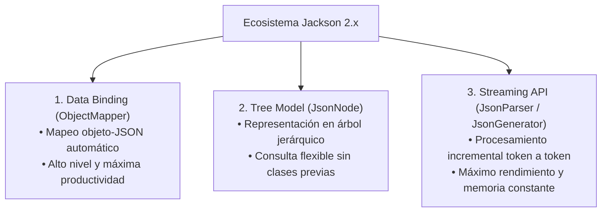
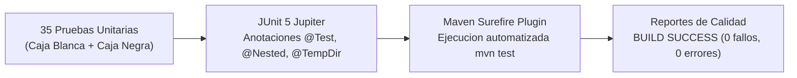

# Documentación Técnica Completa: Investigación de la Librería Jackson en Java

> **Módulo**: Acceso a Datos / Manejo de Ficheros (UD02)  
> **Ciclo**: Desarrollo de Aplicaciones Multiplataforma (DAM)  
> **Autores**: Eduardo Cruz Muñoz y Ángel Miranda  
> **Repositorio del proyecto**: [https://github.com/EduardoCruzmunioz/JacksonInvestigacion](https://github.com/EduardoCruzmunioz/JacksonInvestigacion)  
> **Repositorio colaborativo grupal**: [https://github.com/Angeell04/edu_angel_actividadGrupos](https://github.com/Angeell04/edu_angel_actividadGrupos)  
> **Librería**: Jackson 2.22.4 (`jackson-databind`, `jackson-core`, `jackson-annotations`)  
> **Material visual**: Presentación en diapositivas disponible en [docs/Cruz_Edu_Miranda_Angel_T2_JSON.pptx](Cruz_Edu_Miranda_Angel_T2_JSON.pptx)

---

## Índice General

1. [Introducción a Jackson y Enfoques de Procesamiento](#1-introducción-a-jackson-y-enfoques-de-procesamiento)
2. [Instrucciones de Ejecución de las Aplicaciones](#2-instrucciones-de-ejecución-de-las-aplicaciones)
   - [2.1 Requisitos del Sistema y Dependencias](#21-requisitos-del-sistema-y-dependencias)
   - [2.2 Fichero de Entrada (`persona.json`)](#22-fichero-de-entrada-personajson)
   - [2.3 Pasos de Ejecución (IntelliJ IDEA y Terminal)](#23-pasos-de-ejecución-intellij-idea-y-terminal)
3. [Código Documentado y Decisiones de Diseño (Clean Code)](#3-código-documentado-y-decisiones-de-diseño-clean-code)
   - [3.1 Modelo de Dominio: `models.Persona`](#31-modelo-de-dominio-modelspersona)
   - [3.2 Tarea 1 (Data Binding): `EscritorJSON` y `LectorJSON`](#32-tarea-1-data-binding-escritorjson-y-lectorjson)
   - [3.3 Tarea 2 (Streaming API): `JacksonStreaming`](#33-tarea-2-streaming-api-jacksonstreaming)
   - [3.4 Tarea Complementaria (Tree Model): `JSONTiempoReal`](#34-tarea-complementaria-tree-model-jsontiemporeal)
4. [Estrategia de Pruebas Unitarias (Caja Blanca y Caja Negra)](#4-estrategia-de-pruebas-unitarias-caja-blanca-y-caja-negra)
   - [4.1 Arquitectura de Pruebas con JUnit 5 y Maven Surefire](#41-arquitectura-de-pruebas-con-junit-5-y-maven-surefire)
   - [4.2 Tablas de Pruebas Requeridas para la Entrega](#42-tablas-de-pruebas-requeridas-para-la-entrega)
   - [4.3 Matriz Exhaustiva de las 35 Pruebas Unitarias](#43-matriz-exhaustiva-de-las-35-pruebas-unitarias)
5. [Evidencias de Ejecución y Corrección de Errores](#5-evidencias-de-ejecución-y-corrección-de-errores)
   - [5.1 Evidencia Empírica de Maven Surefire (`BUILD SUCCESS`)](#51-evidencia-empírica-de-maven-surefire-build-success)
   - [5.2 Diagnóstico y Resolución de Errores Encontrados](#52-diagnóstico-y-resolución-de-errores-encontrados)
6. [Comparativa Técnica Global y Elección Arquitectónica](#6-comparativa-técnica-global-y-elección-arquitectónica)

---

## 1. Introducción a Jackson y Enfoques de Procesamiento

Jackson es el estándar de facto en Java para la serialización y deserialización de documentos JSON. A diferencia de la serialización binaria nativa de Java (`Serializable` / `ObjectOutputStream`), Jackson trabaja sobre texto plano estructurado UTF-8 interoperable y ligero.

Ofrece tres paradigmas de procesamiento:



| Enfoque | Componentes principales | Analogía didáctica | Cuándo utilizarlo |
| :--- | :--- | :--- | :--- |
| **Data Binding** | `ObjectMapper`, `TypeReference`, `Persona` | Un **traductor automático** | Desarrollo de APIs REST, servicios web y CRUD estándar con POJOs. |
| **Tree Model** | `ObjectMapper.readTree`, `JsonNode` | Un **mapa del documento** | Parseo rápido, scripts y JSONs dinámicos de esquema desconocido. |
| **Streaming API** | `JsonFactory`, `JsonParser`, `JsonGenerator` | **Leer un libro página a página** | Archivos gigantescos (Gb), streams en tiempo real, microservicios e IoT. |

---

## 2. Instrucciones de Ejecución de las Aplicaciones

### 2.1 Requisitos del Sistema y Dependencias

* **Sistema Operativo**: Windows, Linux o macOS.
* **JDK**: OpenJDK 21 LTS o superior (desarrollado y verificado en OpenJDK 26).
* **Gestor de Compilación**: Apache Maven 3.9+.
* **Dependencias Maven (`pom.xml`)**:
  * `com.fasterxml.jackson.core:jackson-databind:2.22.4` (incluye `jackson-core` y `jackson-annotations`).
  * `org.junit.jupiter:junit-jupiter:5.11.3` (para ejecución de tests).
  * `org.apache.maven.plugins:maven-surefire-plugin:3.5.2`.

### 2.2 Fichero de Entrada (`persona.json`)

* **Ubicación física**: `src/main/resources/persona.json`.
* **Estructura**: Lista JSON de entidades (`[ { "nombre": "...", "apellidos": "...", "edad": ... }, ... ]`).
* **Resiliencia**: Si el archivo físico no existe o está vacío (0 bytes), las aplicaciones crean automáticamente los directorios padre y escriben el array inicial.

### 2.3 Pasos de Ejecución (IntelliJ IDEA y Terminal)

#### Opción A: Desde IntelliJ IDEA
1. Abrir la carpeta del proyecto en IntelliJ IDEA.
2. Esperar a que Maven importe las dependencias del `pom.xml`.
3. Navegar a `src/main/java/` y hacer clic derecho sobre la clase deseada -> **Run 'NombreClase.main()'**:
   * `EscritorJSON`: Agrega una persona acumulándola en el fichero.
   * `LectorJSON`: Lee y muestra por consola todos los registros almacenados.
   * `JSONTiempoReal`: Solicita interactivamente los datos por teclado y procesa el JSON en memoria.
   * `JacksonStreaming`: Solicita interactivamente los datos, actualiza el fichero en streaming y lee los tokens.

#### Opción B: Desde Terminal (PowerShell / Bash / CMD en cualquier equipo)

Los comandos son universales e independientes del equipo o sistema operativo (Windows, Linux, macOS), utilizando rutas relativas al proyecto:

```bash
# 1. Clonar el repositorio y situarse en la raíz del proyecto
git clone https://github.com/EduardoCruzmunioz/JacksonInvestigacion.git
cd JacksonInvestigacion

# 2. Compilar el proyecto y resolver dependencias
mvn clean compile

# 3. Ejecutar la suite completa de 35 pruebas unitarias
mvn test

# 4. Ejecutar cualquiera de las aplicaciones directamente por consola:
mvn exec:java "-Dexec.mainClass=EscritorJSON"
mvn exec:java "-Dexec.mainClass=LectorJSON"
mvn exec:java "-Dexec.mainClass=JSONTiempoReal"
mvn exec:java "-Dexec.mainClass=JacksonStreaming"
```

---

## 3. Código Documentado y Decisiones de Diseño (Clean Code)

### 3.1 Modelo de Dominio: `models.Persona`

```java
package models;

import java.util.Objects;

/**
 * Entidad de dominio Persona.
 * Disenada siguiendo el patron POJO / JavaBean requerido por el Data Binding de Jackson.
 */
public class Persona {
    private String nombre;
    private String apellidos;
    private int edad;

    // Decision de diseno: Constructor vacio OBLIGATORIO.
    // Jackson instancia los objetos por reflexion antes de invocar los setters.
    public Persona() { }

    public Persona(String nombre, String apellidos, int edad) {
        this.nombre = nombre;
        this.apellidos = apellidos;
        this.edad = edad;
    }

    // Getters y Setters requeridos para acceder a los atributos privados
    public String getNombre() { return nombre; }
    public void setNombre(String nombre) { this.nombre = nombre; }

    public String getApellidos() { return apellidos; }
    public void setApellidos(String apellidos) { this.apellidos = apellidos; }

    public int getEdad() { return edad; }
    public void setEdad(int edad) { this.edad = edad; }

    // Decision de diseno: Implementacion de equals y hashCode
    // Permite validar de forma limpia la igualdad de objetos en las aserciones de JUnit.
    @Override
    public boolean equals(Object o) {
        if (this == o) return true;
        if (o == null || getClass() != o.getClass()) return false;
        Persona persona = (Persona) o;
        return edad == persona.edad &&
                Objects.equals(nombre, persona.nombre) &&
                Objects.equals(apellidos, persona.apellidos);
    }

    @Override
    public int hashCode() {
        return Objects.hash(nombre, apellidos, edad);
    }
}
```

---

### 3.2 Tarea 1 (Data Binding): `EscritorJSON` y `LectorJSON`

#### Escritura Acumulativa (`EscritorJSON.java`)

```java
public class EscritorJSON {
    // Reutilizacion estatica de ObjectMapper con formato indentado legible
    private static final ObjectMapper MAPPER = new ObjectMapper()
            .enable(SerializationFeature.INDENT_OUTPUT);

    /**
     * Agrega una persona al fichero JSON preservando los registros previos.
     */
    public static List<Persona> agregarPersona(Path ruta, Persona nueva) throws IOException {
        Objects.requireNonNull(ruta, "La ruta del fichero no puede ser nula");
        Objects.requireNonNull(nueva, "El registro de persona a guardar no puede ser nulo");

        if (ruta.getParent() != null) {
            Files.createDirectories(ruta.getParent());
        }

        File archivo = ruta.toFile();
        ArrayList<Persona> personas = new ArrayList<>();

        // Decision tecnica: TypeReference resuelve el borrado de tipos genericos (type erasure)
        if (archivo.exists() && archivo.length() > 0) {
            personas = MAPPER.readValue(archivo, new TypeReference<ArrayList<Persona>>() {});
        }

        personas.add(nueva);
        MAPPER.writeValue(archivo, personas);
        return personas;
    }

    static void main() {
        Path ruta = Paths.get("src", "main", "resources", "persona.json");
        Persona nueva = new Persona("Angel", "Miranda", 22);
        try {
            List<Persona> personas = agregarPersona(ruta, nueva);
            System.out.println("Registros en el fichero: " + personas.size());
        } catch (IOException e) {
            e.printStackTrace();
        }
    }
}
```

#### Lectura Tipada (`LectorJSON.java`)

```java
public class LectorJSON {
    private static final ObjectMapper MAPPER = new ObjectMapper();

    public static List<Persona> leerPersonas(Path ruta) throws IOException {
        Objects.requireNonNull(ruta, "La ruta del fichero no puede ser nula");
        File archivo = ruta.toFile();
        if (!archivo.exists()) {
            throw new FileNotFoundException("El archivo no existe en la ruta: " + ruta.toAbsolutePath());
        }
        return MAPPER.readValue(archivo, new TypeReference<ArrayList<Persona>>() {});
    }

    static void main() {
        Path ruta = Paths.get("src", "main", "resources", "persona.json");
        try {
            List<Persona> personas = leerPersonas(ruta);
            for (Persona p : personas) {
                System.out.println(p.getNombre() + " " + p.getApellidos() + ", " + p.getEdad());
            }
        } catch (IOException e) {
            e.printStackTrace();
        }
    }
}
```

---

### 3.3 Tarea 2 (Streaming API): `JacksonStreaming`

```java
public class JacksonStreaming {
    private static final JsonFactory FACTORY = new JsonFactory();

    public static void agregarPersonaStreaming(Path ruta, String nombre, String apellidos, int edad) throws IOException {
        Objects.requireNonNull(ruta, "La ruta del fichero no puede ser nula");

        // Decision de diseno: Leemos el contenido previo a memoria antes de abrir el generator
        // para prevenir bloqueos de concurrencia I/O en el sistema de ficheros.
        String anterior = Files.exists(ruta) ? Files.readString(ruta) : "";

        try (JsonGenerator gen = FACTORY.createGenerator(ruta.toFile(), JsonEncoding.UTF8)) {
            gen.useDefaultPrettyPrinter();
            gen.writeStartArray();

            // Decision de diseno: copyCurrentStructure() clona estructuras JSON directamente
            // de stream a stream con coste computacional y de memoria minimo.
            if (!anterior.isBlank()) {
                try (JsonParser viejo = FACTORY.createParser(anterior)) {
                    JsonToken tokenInicial = viejo.nextToken();
                    if (tokenInicial == JsonToken.START_ARRAY) {
                        while (viejo.nextToken() == JsonToken.START_OBJECT) {
                            gen.copyCurrentStructure(viejo);
                        }
                    } else if (tokenInicial == JsonToken.START_OBJECT) {
                        // Compatibilidad transparente con ficheros legacy de un unico objeto { }
                        gen.copyCurrentStructure(viejo);
                    }
                }
            }

            // Emision en streaming (escapando automaticamente caracteres conflictivos)
            gen.writeStartObject();
            gen.writeStringField("nombre", nombre);
            gen.writeStringField("apellidos", apellidos);
            gen.writeNumberField("edad", edad);
            gen.writeEndObject();

            gen.writeEndArray();
        }
    }

    public static List<Persona> leerPersonasStreamingDesdeParser(JsonParser parser) throws IOException {
        List<Persona> personas = new ArrayList<>();
        parser.nextToken(); // Salta a START_ARRAY

        while (parser.nextToken() == JsonToken.START_OBJECT) {
            String nombre = "";
            String apellidos = "";
            int edad = 0;

            while (parser.nextToken() != JsonToken.END_OBJECT) {
                String campo = parser.currentName();
                parser.nextToken(); // Salta al token de valor

                switch (campo) {
                    case "nombre" -> nombre = parser.getText();
                    case "apellidos" -> apellidos = parser.getText();
                    case "edad" -> edad = parser.getIntValue();
                    // Decision de diseno: skipChildren() otorga tolerancia a campos desconocidos
                    default -> parser.skipChildren();
                }
            }
            personas.add(new Persona(nombre, apellidos, edad));
        }
        return personas;
    }
}
```

---

### 3.4 Tarea Complementaria (Tree Model): `JSONTiempoReal`

```java
public class JSONTiempoReal {
    private static final ObjectMapper MAPPER = new ObjectMapper();

    // 1. GENERACION MANUAL: Concatenacion directa en String
    public static String generarJson(String nombre, String apellidos, int edad) {
        return "{ \"nombre\": \"" + nombre + "\", "
                + "\"apellidos\": \"" + apellidos + "\", "
                + "\"edad\": " + edad + " }";
    }

    // 2. INTERPRETACION: Mapeo a arbol DOM (JsonNode)
    public static JsonNode interpretarJson(String json) throws IOException {
        Objects.requireNonNull(json, "La cadena JSON no puede ser nula");
        if (json.isBlank()) {
            throw new IllegalArgumentException("La cadena JSON no puede estar vacia");
        }
        return MAPPER.readTree(json);
    }
}
```

> [!WARNING]
> **Punto débil demostrado**: La concatenación manual en `generarJson` no escapa comillas dobles. Si el usuario introduce `Juan "El Rápido"`, el JSON se corrompe y `readTree` lanza `JsonParseException`. En cambio, `JacksonStreaming` y `EscritorJSON` usan los generadores formales de Jackson que escapan automáticamente cualquier carácter.

---

## 4. Estrategia de Pruebas Unitarias (Caja Blanca y Caja Negra)

### 4.1 Arquitectura de Pruebas con JUnit 5 y Maven Surefire



* **Aislamiento absoluto con `@TempDir`**: Las pruebas nunca tocan el fichero real de recursos en las pruebas de escritura; cada test opera en un sandbox efímero en disco.
* **Patrón AAA (Arrange, Act, Assert)**: Estructuración limpia de cada método de test.
* **Nombres semánticos en español**: Test autoexplicativos que documentan el comportamiento esperado del código.

---

### 4.2 Tablas de Pruebas Requeridas para la Entrega

#### Tabla A: Pruebas de Data Binding (`EscritorJSON` / `LectorJSON`)

| Caso / Tipo | Entrada Utilizada | Resultado Esperado | Resultado Obtenido | Valoración |
| :--- | :--- | :--- | :--- | :--- |
| **1. Funcionamiento Normal** (Round-Trip) | `Persona("Laura", "Gómez Serrano", 29)` | Inserción en fichero existente, acumulación de registros y lectura idéntica con `equals()`. | Registro persistido con indentación; `LectorJSON` recupera los mismos campos. | **CORRECTO** |
| **2. Caso Límite** (Valores Límite BVA y Caracteres Especiales) | Recién nacido (`edad = 0`, `Mateo Peña Nieto`) y centenario (`edad = 102`, `Antonio O'Connor Jiménez`) | Deserialización exacta de valores numéricos límite y respeto estricto de tildes y apóstrofes UTF-8. | Enteros recuperados con precisión (`0` y `102`); cadenas íntegras sin corrupción. | **CORRECTO** |
| **3. Entrada Incorrecta / Inexistente** | Ruta garantizada como inexistente en `tempDir` | Captura y lanzamiento defensivo de `FileNotFoundException` informativo. | Lanza `FileNotFoundException: El archivo no existe en la ruta...`. | **CORRECTO** |

#### Tabla B: Pruebas de Streaming API (`JacksonStreaming`)

| Caso / Tipo | Entrada Utilizada | Resultado Esperado | Resultado Obtenido | Valoración |
| :--- | :--- | :--- | :--- | :--- |
| **1. Funcionamiento Normal** | `Mario`, `Torredelcampo`, `19` | Apertura de array, emisión secuencial de tokens y lectura token a token. | Reconstrucción íntegra de la persona mediante `JsonParser`. | **CORRECTO** |
| **2. Caso Límite** (Comillas dobles internas) | `Juan "El Rápido"`, `Pérez`, `35` | `JsonGenerator` debe escapar automáticamente `\"` evitando que se rompa el JSON. | JSON válido generado; `leerPersonasStreaming` recupera `Juan "El Rápido"` íntegro. | **CORRECTO** |
| **3. Entrada Incorrecta / Formato Legacy** | Fichero antiguo que contiene un objeto único `{ "nombre": "Angel", ... }` | Detección de `START_OBJECT` y migración automática a array `[ ]` con 2 personas. | Objeto previo clonado y nueva persona agregada dentro del array sin error. | **CORRECTO** |

---

### 4.3 Matriz Exhaustiva de las 35 Pruebas Unitarias

```text
Suite Total: 35 Tests Ejecutados con Éxito

├── EscritorJSONTest (6 tests)
│   ├── Caja Negra: Round-trip completo, acumulación secuencial, rechazo de nulos.
│   └── Caja Blanca: Creación de directorios, fichero vacío (0 bytes), formato INDENT_OUTPUT.
├── LectorJSONTest (6 tests)
│   ├── Caja Negra: Lectura de 10 personas reales, límites 0 y 102 años, rechazo de nulos.
│   └── Caja Blanca: Fichero inexistente (FNE), objeto en vez de array (MismatchedInput), JSON corrupto.
├── JSONTiempoRealTest (13 tests)
│   ├── Caja Negra: Generación estándar, parseo JsonNode, edades límite (paramétrica), punto débil con comillas.
│   └── Caja Blanca: Cadenas vacías/espacios, sintaxis truncada, validación ObjectNode, campos nulos, valores por defecto.
└── JacksonStreamingTest (10 tests)
    ├── Caja Negra: Flujo streaming, orden secuencial, comillas escapadas automáticamente, límites y UTF-8, nulos.
    └── Caja Blanca: START_ARRAY inicial, copyCurrentStructure con array, migración de objeto único, FNE, skipChildren con campos desconocidos.
```

---

## 5. Evidencias de Ejecución y Corrección de Errores

### 5.1 Evidencia Empírica de Maven Surefire (`BUILD SUCCESS`)

Salida real obtenida en la ejecución automatizada con Maven 3.9 y OpenJDK 26:

```text
[INFO] -------------------------------------------------------
[INFO]  T E S T S
[INFO] -------------------------------------------------------
[INFO] Running EscritorJSONTest$PruebasCajaBlanca
[INFO] Tests run: 3, Failures: 0, Errors: 0, Skipped: 0
[INFO] Running EscritorJSONTest$PruebasCajaNegra
[INFO] Tests run: 3, Failures: 0, Errors: 0, Skipped: 0
[INFO] Running JacksonStreamingTest$PruebasCajaBlanca
[INFO] Tests run: 5, Failures: 0, Errors: 0, Skipped: 0
[INFO] Running JacksonStreamingTest$PruebasCajaNegra
[INFO] Tests run: 5, Failures: 0, Errors: 0, Skipped: 0
[INFO] Running JSONTiempoRealTest$PruebasCajaBlanca
[INFO] Tests run: 7, Failures: 0, Errors: 0, Skipped: 0
[INFO] Running JSONTiempoRealTest$PruebasCajaNegra
[INFO] Tests run: 6, Failures: 0, Errors: 0, Skipped: 0
[INFO] Running LectorJSONTest$PruebasCajaBlanca
[INFO] Tests run: 3, Failures: 0, Errors: 0, Skipped: 0
[INFO] Running LectorJSONTest$PruebasCajaNegra
[INFO] Tests run: 3, Failures: 0, Errors: 0, Skipped: 0
[INFO] 
[INFO] Results:
[INFO] Tests run: 35, Failures: 0, Errors: 0, Skipped: 0
[INFO] ------------------------------------------------------------------------
[INFO] BUILD SUCCESS (Total time: 4.667 s)
[INFO] ------------------------------------------------------------------------
```

### 5.2 Diagnóstico y Resolución de Errores Encontrados

1. **Error de localización de recursos (`getResource` vs `Paths.get`)**:
   * *Problema*: `ClassLoader.getResource` buscaba en `target/classes`, provocando que las escrituras no se reflejaran de inmediato en el código fuente.
   * *Solución*: Estandarización a ruta directa de proyecto mediante `Paths.get("src", "main", "resources", "persona.json")`.
2. **Sobrescritura involuntaria del histórico**:
   * *Problema*: `writeValue` sobrescribía el archivo perdiendo las personas anteriores.
   * *Solución*: Patrón de lectura previa con `TypeReference<ArrayList<Persona>>`, anexado a la lista y reescritura completa.
3. **Bloqueo concurrente de fichero en Streaming**:
   * *Problema*: Abrir a la vez un parser y un generator sobre el mismo archivo bloqueaba el archivo en Windows.
   * *Solución*: Lectura previa del fichero a una cadena `String anterior` en memoria antes de abrir el `JsonGenerator`.
4. **Vulnerabilidad de comillas en JSON manual**:
   * *Problema*: Introducir comillas en `JSONTiempoReal` provocaba `JsonParseException`.
   * *Solución y Aprendizaje*: Se constató que para entradas de usuario siempre deben emplearse generadores formales (`ObjectMapper` o `JsonGenerator`), los cuales escapan automáticamente las secuencias especiales.

---

## 6. Comparativa Técnica Global y Elección Arquitectónica

| Dimensión | Data Binding (`Escritor`/`Lector`) | Tree Model (`JSONTiempoReal`) | Streaming API (`JacksonStreaming`) |
| :--- | :--- | :--- | :--- |
| **Nivel de Abstracción** | Muy alto (automático) | Medio (árbol de nodos) | Bajo (eventos y tokens) |
| **Requiere Clases POJO** | Sí (`models.Persona`) | No | No |
| **Consumo de Memoria RAM** | Proporcional a la colección de objetos | Proporcional al árbol DOM completo | **Mínimo y constante** ($O(1)$) |
| **Velocidad de Procesamiento** | Rápida | Rápida | **Ultra rápida (máxima)** |
| **Seguridad con Comillas** | Total (automática) | **Vulnerable** (en concatenación) | Total (automática) |
| **Facilidad y Mantenimiento** | **Máxima** (código mínimo) | Media | Compleja (control granular) |
| **Veredicto / Recomendación** | **Elección estándar** para el 95% de desarrollos empresariales y APIs. | Ideal para scripts exploratorios y JSONs dinámicos. | **Imprescindible** para ficheros masivos (>500MB) o arquitecturas con recursos limitados. |
