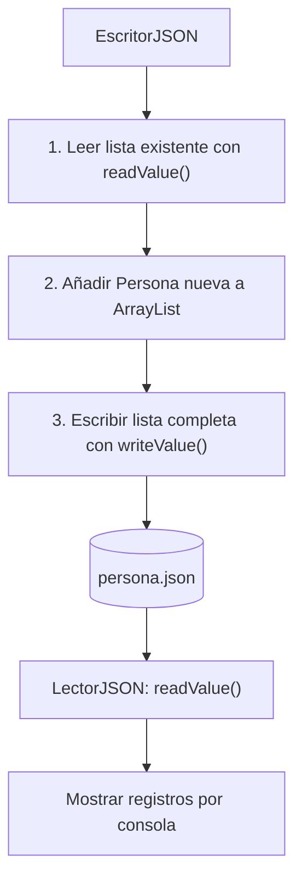

# Guía Técnica: Investigación de la Librería Jackson en Java

> **Módulo**: Acceso a Datos / Manejo de Ficheros (UD02)  
> **Tema**: Interpretación y generación de JSON en tiempo real con Jackson  
> **Autores**: Eduardo Cruz Muñoz y Ángel Miranda ([@Angeell04](https://github.com/Angeell04))  
> **Repositorio colaborativo**: [Angeell04/edu_angel_actividadGrupos](https://github.com/Angeell04/edu_angel_actividadGrupos)  
> **Librería**: Jackson 2.22.4 (`jackson-databind`, `jackson-core`, `jackson-annotations`)

---

## Índice

1. [Introducción a Jackson y sus Tres Enfoques](#1-introducción-a-jackson-y-sus-tres-enfoques)
2. [Enfoque 1 (Demo 1): Data Binding con `EscritorJSON` y `LectorJSON`](#2-enfoque-1-demo-1-data-binding-con-escritorjson-y-lectorjson)
   - [2.1 La clase de dominio `Persona`](#21-la-clase-de-dominio-persona)
   - [2.2 `EscritorJSON`: Escritura y acumulación](#22-escritorjson-escritura-y-acumulación)
   - [2.3 `LectorJSON`: Deserialización tipada](#23-lectorjson-deserialización-tipada)
   - [2.4 Flujo conjunto y evolución del fichero](#24-flujo-conjunto-y-evolución-del-fichero)
   - [2.5 Errores típicos y soluciones](#25-errores-típicos-y-soluciones)
3. [Enfoque 2 (Demo 2): Modelo de Árbol con `JSONTiempoReal`](#3-enfoque-2-demo-2-modelo-de-árbol-con-jsontiemporeal)
   - [3.1 Código fuente](#31-código-fuente)
   - [3.2 Cómo funciona paso a paso](#32-cómo-funciona-paso-a-paso)
   - [3.3 Ejemplo de ejecución interactiva](#33-ejemplo-de-ejecución-interactiva)
   - [3.4 Punto débil identificado](#34-punto-débil-identificado)
4. [Enfoque 3 (Demo 3): Streaming API con `JacksonStreaming`](#4-enfoque-3-demo-3-streaming-api-con-jacksonstreaming)
   - [4.1 Componentes del Streaming API](#41-componentes-del-streaming-api)
   - [4.2 Código fuente](#42-código-fuente)
   - [4.3 Flujo paso a paso](#43-flujo-paso-a-paso)
   - [4.4 Tabla de tokens: Cómo lee el parser](#44-tabla-de-tokens-cómo-lee-el-parser)
   - [4.5 Preservación de histórico y compatibilidad](#45-preservación-de-histórico-y-compatibilidad)
5. [Comparativa Global de los Enfoques](#5-comparativa-global-de-los-enfoques)
6. [Chuleta Rápida de Métodos Jackson](#6-chuleta-rápida-de-métodos-jackson)
7. [Preguntas Clave para Repaso y Examen](#7-preguntas-clave-para-repaso-y-examen)

---

## 1. Introducción a Jackson y sus Tres Enfoques

Jackson es una de las librerías más potentes y utilizadas en el ecosistema Java para procesar documentos JSON. Ofrece tres paradigmas complementarios:

| Enfoque | Clases principales | Analogía | Cuándo usarlo |
| :--- | :--- | :--- | :--- |
| **Data Binding** | `ObjectMapper`, `TypeReference`, `Persona` | Un **traductor automático** | En el día a día para desarrollo de APIs REST y aplicaciones CRUD con POJOs. |
| **Tree Model (Árbol)** | `ObjectMapper.readTree`, `JsonNode` | Un **mapa del JSON** | Para inspeccionar o manipular JSONs dinámicos sin crear clases previas. |
| **Streaming API** | `JsonFactory`, `JsonParser`, `JsonGenerator` | **Leer un libro página a página** | Cuando la velocidad o la memoria son críticas (ficheros enormes o IoT). |

> [!NOTE]
> Ninguno de los programas utiliza la serialización nativa de Java (`Serializable` / `ObjectOutputStream`). Todo el procesamiento se realiza mediante los motores estándar de Jackson en formato de texto plano estructurado UTF-8.

### Dependencia Maven (`pom.xml`)

```xml
<dependency>
    <groupId>com.fasterxml.jackson.core</groupId>
    <artifactId>jackson-databind</artifactId>
    <version>2.22.4</version>
</dependency>
```

Al declarar `jackson-databind`, Maven resuelve y descarga automáticamente `jackson-core` (Streaming API) y `jackson-annotations`.

---

## 2. Enfoque 1 (Demo 1): Data Binding con `EscritorJSON` y `LectorJSON`

Es el enfoque más productivo. Jackson mapea directamente entre las propiedades del JSON y los atributos de la clase Java.

### 2.1 La clase de dominio `Persona`

Ubicada en el paquete `models`, representa los registros almacenados en `src/main/resources/persona.json`:

```java
package models;

public class Persona {
    private String nombre;
    private String apellidos;
    private int edad;

    // 1. Constructor vacío OBLIGATORIO para que Jackson pueda instanciar por reflexión
    public Persona() { }

    public Persona(String nombre, String apellidos, int edad) {
        this.nombre = nombre;
        this.apellidos = apellidos;
        this.edad = edad;
    }

    // 2. Getters y Setters requeridos para lectura y escritura de atributos privados
    public String getNombre() { return nombre; }
    public void setNombre(String nombre) { this.nombre = nombre; }

    public String getApellidos() { return apellidos; }
    public void setApellidos(String apellidos) { this.apellidos = apellidos; }

    public int getEdad() { return edad; }
    public void setEdad(int edad) { this.edad = edad; }
}
```

> [!IMPORTANT]
> Los nombres de los campos (`nombre`, `apellidos`, `edad`) deben coincidir exactamente con las claves del JSON. Además, se implementan `equals()` y `hashCode()` para facilitar las pruebas unitarias automatizadas.

---

### 2.2 `EscritorJSON`: Escritura y acumulación

Para evitar sobrescribir el fichero y perder el histórico, el programa sigue un patrón de lectura previa, adición y reescritura:

```java
public static List<Persona> agregarPersona(Path ruta, Persona nueva) throws IOException {
    if (ruta.getParent() != null) {
        Files.createDirectories(ruta.getParent());
    }

    File archivo = ruta.toFile();
    ArrayList<Persona> personas = new ArrayList<>();

    // 1. Si el fichero existe y tiene contenido, recuperamos el histórico
    if (archivo.exists() && archivo.length() > 0) {
        personas = MAPPER.readValue(archivo, new TypeReference<ArrayList<Persona>>() {});
    }

    // 2. Acumulamos el nuevo registro
    personas.add(nueva);

    // 3. Reescribimos la lista completa con formato indentado
    MAPPER.writeValue(archivo, personas);

    return personas;
}
```

* **`TypeReference<ArrayList<Persona>>`**: Imprescindible para superar el borrado de tipos (*type erasure*) de Java. Permite a Jackson saber que la lista contiene objetos `Persona` y no simples `Map`.
* **`SerializationFeature.INDENT_OUTPUT`**: Habilita el formateo legible con saltos de línea y sangría.

---

### 2.3 `LectorJSON`: Deserialización tipada

Lee el fichero de disco y devuelve la colección fuertemente tipada:

```java
public static List<Persona> leerPersonas(Path ruta) throws IOException {
    File archivo = ruta.toFile();
    if (!archivo.exists()) {
        throw new FileNotFoundException("El archivo no existe en la ruta: " + ruta.toAbsolutePath());
    }

    return MAPPER.readValue(archivo, new TypeReference<ArrayList<Persona>>() {});
}
```

---

### 2.4 Flujo conjunto y evolución del fichero



---

### 2.5 Errores típicos y soluciones

| Error | Causa | Solución |
| :--- | :--- | :--- |
| `MismatchedInputException` | El fichero contiene un objeto `{}` y se intenta leer como lista `[]`. | Normalizar el fichero como lista `[]` o configurar `ACCEPT_SINGLE_VALUE_AS_ARRAY`. |
| `UnrecognizedPropertyException` | El JSON tiene una clave que no existe en `Persona`. | Alinear los nombres de los atributos con las claves JSON. |
| `InvalidDefinitionException` | Falta el constructor vacío en `Persona`. | Añadir `public Persona() { }`. |
| `FileNotFoundException` | Se ejecuta el lector antes de que el escritor cree el archivo. | Ejecutar primero `EscritorJSON` o verificar la existencia con `Files.exists()`. |

---

## 3. Enfoque 2 (Demo 2): Modelo de Árbol con `JSONTiempoReal`

Permite procesar JSONs en memoria sin necesidad de crear clases Java intermedias.

### 3.1 Código fuente

```java
public class JSONTiempoReal {
    private static final ObjectMapper MAPPER = new ObjectMapper();

    // 1. GENERACIÓN: Construcción manual de la cadena JSON
    public static String generarJson(String nombre, String apellidos, int edad) {
        return "{ \"nombre\": \"" + nombre + "\", "
                + "\"apellidos\": \"" + apellidos + "\", "
                + "\"edad\": " + edad + " }";
    }

    // 2. INTERPRETACIÓN: Parseo al modelo de árbol DOM
    public static JsonNode interpretarJson(String json) throws IOException {
        return MAPPER.readTree(json);
    }
}
```

### 3.2 Cómo funciona paso a paso

1. **Generación**: Pide datos con `Scanner` y ensambla la cadena JSON concatenando comillas y variables.
2. **Interpretación**: `MAPPER.readTree(json)` analiza el texto y genera un árbol jerárquico de nodos (`JsonNode`).
3. **Navegación**: Se accede a cada propiedad por su nombre:
   * `raiz.get("nombre").asText()` -> Devuelve el texto.
   * `raiz.get("edad").asInt()` -> Devuelve el entero primitivo.

### 3.3 Ejemplo de ejecución interactiva

```text
Nombre: Edu
Apellidos: Cruz Muñoz
Edad: 22

JSON generado:
{ "nombre": "Edu", "apellidos": "Cruz Muñoz", "edad": 22 }

JSON interpretado:
nombre = Edu
apellidos = Cruz Muñoz
edad = 22
```

### 3.4 Punto débil identificado

Al construir el JSON mediante concatenación de texto plano, **si el usuario introduce comillas dobles en su nombre** (por ejemplo: `Juan "El Rápido"`):
* La cadena resultante queda sintácticamente rota: `{ "nombre": "Juan "El Rápido"", ... }`.
* `readTree` lanza un error inmediato: `JsonParseException: Unexpected character ('E' (code 69))`.

> [!WARNING]
> Este problema demuestra por qué en entornos de producción nunca debe concatenarse JSON a mano, debiendo recurrir a serializadores formales como `ObjectMapper` o `JsonGenerator`.

---

## 4. Enfoque 3 (Demo 3): Streaming API con `JacksonStreaming`

Es el enfoque de más bajo nivel y máximo rendimiento. Procesa el documento evento a evento sin cargar el árbol completo ni crear objetos en memoria.

### 4.1 Componentes del Streaming API

* **`JsonFactory`**: Fábrica que instancia parsers y generators.
* **`JsonGenerator`**: Emisor secuencial de tokens hacia el destino (`writeStartObject`, `writeStringField`, `writeNumberField`, `writeEndObject`).
* **`JsonParser`**: Lector de flujo secuencial token a token (`nextToken`, `currentName`, `getText`, `getIntValue`).
* **`JsonToken`**: Enumeración que clasifica el token actual (`START_ARRAY`, `START_OBJECT`, `FIELD_NAME`, `VALUE_STRING`, `VALUE_NUMBER_INT`, `END_OBJECT`).

---

### 4.2 Código fuente esencial

```java
// ESCRITURA EN STREAMING
try (JsonGenerator gen = FACTORY.createGenerator(ruta.toFile(), JsonEncoding.UTF8)) {
    gen.useDefaultPrettyPrinter();
    gen.writeStartArray();

    // Copiado del histórico existente sin instanciar objetos intermedios
    if (!anterior.isBlank()) {
        try (JsonParser viejo = FACTORY.createParser(anterior)) {
            JsonToken t = viejo.nextToken();
            if (t == JsonToken.START_ARRAY) {
                while (viejo.nextToken() == JsonToken.START_OBJECT) {
                    gen.copyCurrentStructure(viejo);
                }
            } else if (t == JsonToken.START_OBJECT) {
                gen.copyCurrentStructure(viejo); // Compatibilidad con objeto único
            }
        }
    }

    // Emisión de la nueva persona (escapando caracteres automáticamente)
    gen.writeStartObject();
    gen.writeStringField("nombre", nombre);
    gen.writeStringField("apellidos", apellidos);
    gen.writeNumberField("edad", edad);
    gen.writeEndObject();

    gen.writeEndArray();
}
```

---

### 4.3 Tabla de tokens: Cómo lee el parser

Ante el siguiente fragmento JSON:

```json
{
  "nombre" : "Edu",
  "edad" : 22
}
```

El `JsonParser` genera la siguiente secuencia de eventos:

| Fragmento analizado | Token devuelto (`nextToken()`) | Método de acceso |
| :--- | :--- | :--- |
| `{` | `START_OBJECT` | Inicio de objeto |
| `"nombre"` | `FIELD_NAME` | `parser.currentName()` -> `"nombre"` |
| `"Edu"` | `VALUE_STRING` | `parser.getText()` -> `"Edu"` |
| `"edad"` | `FIELD_NAME` | `parser.currentName()` -> `"edad"` |
| `22` | `VALUE_NUMBER_INT` | `parser.getIntValue()` -> `22` |
| `}` | `END_OBJECT` | Fin de objeto |

---

### 4.4 Preservación de histórico y compatibilidad

1. **Evitar colisiones I/O**: No se puede abrir un lector y un escritor simultáneos sobre el mismo archivo. Se carga el archivo previo en un `String anterior` antes de instanciar el generator.
2. **`copyCurrentStructure(viejo)`**: Copia directamente los subárboles de tokens del parser antiguo al generator nuevo con coste computacional casi nulo.
3. **Resiliencia ante esquemas legacy**: Detecta si el fichero previo era un array (`START_ARRAY`) o un objeto único (`START_OBJECT`), migrándolo automáticamente sin lanzar excepciones.

---

## 5. Comparativa Global de los Enfoques

| Característica | Data Binding (`Escritor`/`Lector`) | Tree Model (`JSONTiempoReal`) | Streaming API (`JacksonStreaming`) |
| :--- | :--- | :--- | :--- |
| **Requiere clases POJO** | Sí (`models.Persona`) | No | No |
| **Consumo de Memoria** | Medio (árbol de objetos) | Medio/Alto (árbol DOM) | **Mínimo y constante** |
| **Velocidad de ejecución** | Alta | Alta | **Máxima** |
| **Seguridad con comillas** | Total (escape automático) | **Vulnerable** (manual) | Total (escape automático) |
| **Complejidad del código** | Muy baja | Muy baja | Media/Alta |
| **Caso de uso recomendado** | Desarrollo estándar de aplicaciones | Exploración y scripts rápidos | Archivos gigantes y streaming masivo |

---

## 6. Chuleta Rápida de Métodos Jackson

### `ObjectMapper` (Data Binding y Árbol)
* `writeValue(File destino, Object valor)`: Serializa cualquier objeto o colección Java a JSON en disco.
* `readValue(File origen, Class<T> clase)`: Deserializa un JSON simple a una instancia de clase.
* `readValue(File origen, TypeReference<T> tipo)`: Deserializa colecciones genéricas (`List<Persona>`).
* `readTree(String json)`: Parsea una cadena de texto y devuelve la raíz como `JsonNode`.
* `enable(SerializationFeature.INDENT_OUTPUT)`: Activa la salida con sangría e indentación legible.

### `JsonNode` (Navegación del Árbol)
* `get("clave")`: Obtiene el nodo hijo correspondiente a la clave (devuelve `null` si no existe).
* `asText()`: Extrae el valor en forma de `String`.
* `asInt()`: Extrae el valor en forma de `int`.
* `isObject()` / `isArray()`: Comprueba el tipo de nodo.

### `JsonGenerator` (Streaming - Escritura)
* `writeStartArray()` / `writeEndArray()`: Abre `[` y cierra `]`.
* `writeStartObject()` / `writeEndObject()`: Abre `{` y cierra `}`.
* `writeStringField("clave", "valor")`: Escribe una propiedad de texto escapando comillas.
* `writeNumberField("clave", numero)`: Escribe una propiedad numérica sin comillas.
* `copyCurrentStructure(JsonParser parser)`: Clona la estructura completa del parser al generator.

### `JsonParser` (Streaming - Lectura)
* `nextToken()`: Avanza al siguiente token del flujo.
* `currentName()`: Devuelve el nombre del campo actual cuando está en `FIELD_NAME`.
* `getText()`: Obtiene el texto del token actual.
* `getIntValue()`: Obtiene el entero del token actual.
* `skipChildren()`: Salta recursivamente un objeto o array desconocido para garantizar resiliencia.

---

## 7. Preguntas Clave para Repaso y Examen

1. **¿Por qué `Persona` necesita un constructor vacío?**  
   Porque Jackson instancia el objeto mediante reflexión antes de invocar los métodos *setter* para rellenar los datos.

2. **¿Por qué usamos `TypeReference` al leer la lista de personas?**  
   Por el borrado de tipos (*type erasure*) de Java. En tiempo de ejecución, Java no sabe qué tipo de elementos contiene un `ArrayList`. `TypeReference` preserva el tipo genérico para Jackson.

3. **¿Cuál es la principal ventaja del Streaming API frente a los otros métodos?**  
   Su consumo de memoria constante. No necesita cargar el fichero completo en RAM, procesándolo elemento a elemento en milisegundos.

4. **¿Por qué falló la concatenación manual de `JSONTiempoReal` con comillas dobles?**  
   Porque Java inserta las comillas literalmente en la cadena, rompiendo la sintaxis JSON. En cambio, `ObjectMapper` y `JsonGenerator` escapan automáticamente los caracteres especiales (`\"`).
