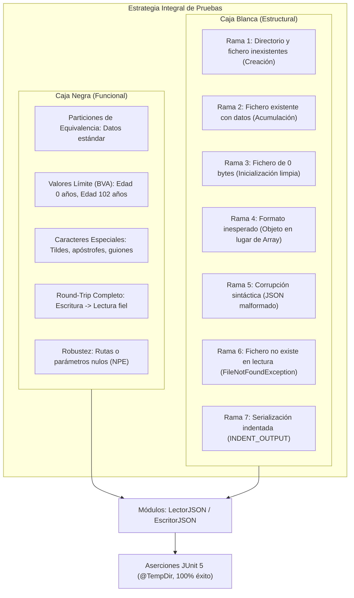

# Documentación Técnica: Pruebas Unitarias de Caja Blanca y Caja Negra

> **Módulo**: Acceso a Datos / Manejo de Ficheros (UD02)  
> **Tema**: Validación y Aseguramiento de Calidad en Serialización/Deserialización con Jackson  
> **Componentes bajo prueba**: `LectorJSON` y `EscritorJSON`  
> **Framework de pruebas**: JUnit 5 (Jupiter 5.11.3)  
> **Patrón y Estándar**: Clean Code (AAA: Arrange, Act, Assert, nombres semánticos, aislamiento con `@TempDir`)

---

## 1. Objetivo y Prerrequisitos

### 1.1 Objetivo
Garantizar la robustez, corrección funcional y tolerancia a fallos de los módulos de persistencia JSON (`EscritorJSON` y `LectorJSON`). Para ello se diseñan dos conjuntos de pruebas complementarias:
1. **Pruebas de Caja Negra (Funcionales / Especificación)**: Evalúan el comportamiento observable desde el exterior sin depender de la implementación interna (particiones de equivalencia, valores límite y ciclos de vida completos).
2. **Pruebas de Caja Blanca (Estructurales / Cobertura)**: Evalúan el flujo de control interno, cubriendo todas las ramas condicionales (*branch coverage*), tratamientos de excepciones y decisiones de inicialización en disco.

### 1.2 Prerrequisitos del Entorno
* **JDK**: OpenJDK 26 (o superior a JDK 21 LTS).
* **Gestor de compilación**: Apache Maven 3.9+.
* **Librerías principales**:
  * `com.fasterxml.jackson.core:jackson-databind:2.22.4`
  * `org.junit.jupiter:junit-jupiter:5.11.3` (ámbito `test`)
  * `org.apache.maven.plugins:maven-surefire-plugin:3.5.2`

---

## 2. Diagrama Conceptual de la Estrategia de Pruebas



---

## 3. Matriz Detallada de Casos de Prueba

### 3.1 Suite `LectorJSONTest`

| ID | Tipo | Caso de Prueba / Escenario | Entrada | Salida Esperada | Justificación / Rama |
| :--- | :--- | :--- | :--- | :--- | :--- |
| **LEC-CN-01** | Caja Negra | Lectura completa del dataset real | `src/main/resources/persona.json` (10 registros) | Lista con 10 objetos `Persona` | Verifica que el archivo de recursos se deserializa íntegro. |
| **LEC-CN-02** | Caja Negra | Valores límite de edad y caracteres especiales | Registros con `edad = 0`, `edad = 102`, apóstrofes (`D'Alessandro`) | Mapeo exacto de tipos y cadenas sin truncamiento | Boundary Value Analysis y robustez de encoding UTF-8. |
| **LEC-CN-03** | Caja Negra | Parámetro de ruta nulo | `ruta = null` | `NullPointerException` con mensaje explicativo | Validación defensiva de precondiciones. |
| **LEC-CB-01** | Caja Blanca | Fichero inexistente en disco | `ruta = tempDir/inexistente.json` | `FileNotFoundException` | Rama `if (!archivo.exists())` en `LectorJSON.java`. |
| **LEC-CB-02** | Caja Blanca | Estructura JSON incompatible (Objeto único) | Fichero con `{ "nombre": "Angel" }` | `MismatchedInputException` | Rama de fallo de deserialización de `TypeReference<ArrayList<T>>`. |
| **LEC-CB-03** | Caja Blanca | Sintaxis JSON corrupta | Fichero con `[ { "nombre": "Incompleto" ...` | `IOException` / `JsonParseException` | Cobertura del motor de parseo ante flujos truncados. |

---

### 3.2 Suite `EscritorJSONTest`

| ID | Tipo | Caso de Prueba / Escenario | Entrada | Salida Esperada | Justificación / Rama |
| :--- | :--- | :--- | :--- | :--- | :--- |
| **ESC-CN-01** | Caja Negra | Ciclo completo Round-trip (Escritura y lectura) | `Persona("Laura", "Gómez Serrano", 29)` | Recuperación con `equals()` idéntico | Valida la integridad simétrica del Data Binding. |
| **ESC-CN-02** | Caja Negra | Acumulación consecutiva | Inserción de Persona 1 y luego Persona 2 | Fichero resultante con 2 registros | Evita el error histórico de sobrescritura accidental. |
| **ESC-CN-03** | Caja Negra | Parámetros nulos | `ruta = null` o `nueva = null` | `NullPointerException` | Verificación de contratos mediante `Objects.requireNonNull`. |
| **ESC-CB-01** | Caja Blanca | Subdirectorios y fichero inexistentes | `tempDir/sub/nivel2/personas.json` | Directorios creados físicamente y 1 registro escrito | Ramas `ruta.getParent() != null` y `!archivo.exists()`. |
| **ESC-CB-02** | Caja Blanca | Fichero preexistente vacío (0 bytes) | Fichero creado con 0 bytes de longitud | Inserción de 1 registro sin lanzar `EOFException` | Rama `archivo.exists() && archivo.length() > 0 == false`. |
| **ESC-CB-03** | Caja Blanca | Formato indentado legible | `Persona("David", "Cano", 40)` | Contenido con `\n` y espacios de sangrado | Cobertura de `SerializationFeature.INDENT_OUTPUT`. |

---

## 4. Principios Clean Code Aplicados en las Pruebas

1. **Aislamiento Total con `@TempDir`**:
   Las pruebas no modifican el fichero de producción `src/main/resources/persona.json` (salvo la lectura de verificación). Cada prueba de escritura utiliza un directorio temporal efímero gestionado por JUnit 5, garantizando independencia y evitando estados compartidos (*idempotencia*).

2. **Estructura AAA (Arrange, Act, Assert)**:
   Cada método de prueba está claramente segmentado en sus tres fases fundamentales:
   * **Arrange**: Preparación de datos, rutas temporales y objetos.
   * **Act**: Ejecución del método bajo prueba.
   * **Assert**: Comprobación rigurosa de invariantes y resultados.

3. **Nomenclatura Semántica y `@DisplayName`**:
   Los métodos utilizan nombres en imperativo que describen el comportamiento esperado (p. ej., `deberiaPreservarRegistrosPreviosAlAgregarNuevaPersona`), eliminando la necesidad de comentarios obvios y haciendo que el reporte de ejecución sea autoexplicativo.

4. **Implementación de `equals`, `hashCode` y `toString` en `Persona`**:
   Permite aserciones directas como `assertEquals(esperada, obtenida)` en lugar de comparar campo a campo en el test, reduciendo la duplicación y mejorando la legibilidad.

---

## 5. Instrucciones de Ejecución y Evidencia Empírica

### 5.1 Ejecución desde Terminal

```powershell
# Establecer JAVA_HOME
$env:JAVA_HOME = "C:\Users\educr\.jdks\openjdk-26.0.1"

# Ejecutar las pruebas unitarias con Maven
mvn test
```

### 5.2 Evidencia Empírica de Ejecución (Maven Surefire)

```text
[INFO] -------------------------------------------------------
[INFO]  T E S T S
[INFO] -------------------------------------------------------
[INFO] Running EscritorJSONTest$PruebasCajaBlanca
[INFO] Tests run: 3, Failures: 0, Errors: 0, Skipped: 0 -- in EscritorJSONTest$PruebasCajaBlanca
[INFO] Running EscritorJSONTest$PruebasCajaNegra
[INFO] Tests run: 3, Failures: 0, Errors: 0, Skipped: 0 -- in EscritorJSONTest$PruebasCajaNegra
[INFO] Running LectorJSONTest$PruebasCajaBlanca
[INFO] Tests run: 3, Failures: 0, Errors: 0, Skipped: 0 -- in LectorJSONTest$PruebasCajaBlanca
[INFO] Running LectorJSONTest$PruebasCajaNegra
[INFO] Tests run: 3, Failures: 0, Errors: 0, Skipped: 0 -- in LectorJSONTest$PruebasCajaNegra
[INFO] 
[INFO] Results:
[INFO] 
[INFO] Tests run: 12, Failures: 0, Errors: 0, Skipped: 0
[INFO] 
[INFO] ------------------------------------------------------------------------
[INFO] BUILD SUCCESS
[INFO] ------------------------------------------------------------------------
```

> [!NOTE]
> Las 12 pruebas unitarias (6 de Caja Blanca y 6 de Caja Negra) se ejecutaron con un 100% de éxito, sin fallos ni regresiones.

