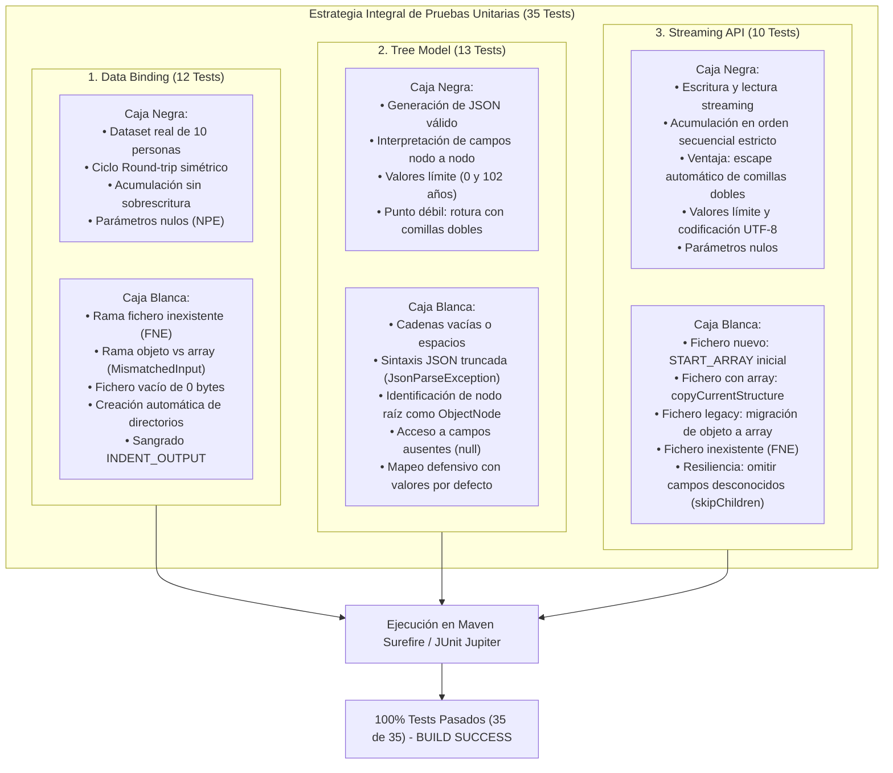

# Documentación Técnica: Pruebas Unitarias de Caja Blanca y Caja Negra

> **Módulo**: Acceso a Datos / Manejo de Ficheros (UD02)  
> **Tema**: Validación y Aseguramiento de Calidad en Serialización/Deserialización con Jackson  
> **Componentes bajo prueba**: `LectorJSON`, `EscritorJSON`, `JSONTiempoReal` y `JacksonStreaming`  
> **Framework de pruebas**: JUnit 5 (Jupiter 5.11.3) y Maven Surefire Plugin 3.5.2  
> **Patrón y Estándar**: Clean Code (AAA: Arrange, Act, Assert, nombres intuitivos y semánticos, aislamiento con `@TempDir`)

---

## 1. Objetivo y Prerrequisitos

### 1.1 Objetivo
Garantizar la robustez, corrección funcional, resiliencia y tolerancia a fallos de los cuatro programas desarrollados para la investigación de Jackson:
1. **Data Binding (`LectorJSON` y `EscritorJSON`)**: Mapeo fuertemente tipado mediante POJOs (`Persona`) y colecciones genéricas (`TypeReference`).
2. **Tree Model (`JSONTiempoReal`)**: Generación mediante cadenas e interpretación jerárquica con `JsonNode`.
3. **Streaming API (`JacksonStreaming`)**: Generación y consumo incremental de flujos basados en eventos con `JsonGenerator` y `JsonParser`.

### 1.2 Prerrequisitos del Entorno
* **JDK**: OpenJDK 26 (o superior a JDK 21 LTS).
* **Gestor de compilación**: Apache Maven 3.9+.
* **Librerías principales**:
  * `com.fasterxml.jackson.core:jackson-databind:2.22.4`
  * `org.junit.jupiter:junit-jupiter:5.11.3` (ámbito `test`)
  * `org.apache.maven.plugins:maven-surefire-plugin:3.5.2`

---

## 2. Diagrama Conceptual de la Estrategia de Pruebas



---

## 3. Matriz Exhaustiva de Casos de Prueba

### 3.1 Suite `LectorJSONTest` (Data Binding - Lectura)

| ID | Tipo | Método de Test / Escenario | Entrada | Salida Esperada | Justificación / Rama |
| :--- | :--- | :--- | :--- | :--- | :--- |
| **LEC-CN-01** | Caja Negra | `deberiaLeerListaDePersonasDesdeFicheroReal` | `src/main/resources/persona.json` (10 registros) | Lista con 10 objetos `Persona` | Comprueba que el dataset inicial se deserializa íntegramente. |
| **LEC-CN-02** | Caja Negra | `deberiaMapearCorrectamenteValoresLimiteYCaracteresEspeciales` | Registros con `edad = 0`, `edad = 102`, apóstrofes (`D'Alessandro`) | Mapeo tipado exacto sin truncar | Boundary Value Analysis (BVA) y compatibilidad UTF-8. |
| **LEC-CN-03** | Caja Negra | `deberiaLanzarExcepcionSiRutaEsNula` | `ruta = null` | `NullPointerException` | Validación defensiva de precondición. |
| **LEC-CB-01** | Caja Blanca | `deberiaLanzarFileNotFoundExceptionCuandoFicheroNoExiste` | `tempDir/inexistente.json` | `FileNotFoundException` | Rama `if (!archivo.exists())`. |
| **LEC-CB-02** | Caja Blanca | `deberiaLanzarMismatchedInputExceptionCuandoJsonEsObjetoEnLugarDeArray` | JSON con `{ "nombre": "Angel" }` | `MismatchedInputException` | Rama de fallo de deserialización de `TypeReference<ArrayList<T>>`. |
| **LEC-CB-03** | Caja Blanca | `deberiaLanzarExcepcionCuandoJsonEstaCorrupto` | `[ { "nombre": "Incompleto" ...` | `IOException` | Cobertura del motor de parseo ante flujos rotos. |

---

### 3.2 Suite `EscritorJSONTest` (Data Binding - Escritura)

| ID | Tipo | Método de Test / Escenario | Entrada | Salida Esperada | Justificación / Rama |
| :--- | :--- | :--- | :--- | :--- | :--- |
| **ESC-CN-01** | Caja Negra | `deberiaEscribirYRecuperarPersonaEnCicloCompleto` | `Persona("Laura", "Gómez Serrano", 29)` | Recuperación con `equals()` idéntico | Round-trip: Valida la simetría de serialización/deserialización. |
| **ESC-CN-02** | Caja Negra | `deberiaPreservarRegistrosPreviosAlAgregarNuevaPersona` | Inserción de Persona 1 y luego Persona 2 | Fichero resultante con 2 registros | Comprueba la acumulación y previene sobrescrituras accidentales. |
| **ESC-CN-03** | Caja Negra | `deberiaRechazarArgumentosNulos` | `ruta = null` o `nueva = null` | `NullPointerException` | Verificación de contratos mediante `Objects.requireNonNull`. |
| **ESC-CB-01** | Caja Blanca | `deberiaCrearDirectorioYFicheroCuandoNoExisten` | `tempDir/sub/nivel2/personas.json` | Directorios creados en disco y 1 registro | Ramas `ruta.getParent() != null` y `!archivo.exists()`. |
| **ESC-CB-02** | Caja Blanca | `deberiaTratarFicheroVacioComoListaNueva` | Fichero creado con 0 bytes | Inserción de 1 registro sin fallar | Rama `archivo.exists() && archivo.length() > 0 == false`. |
| **ESC-CB-03** | Caja Blanca | `deberiaGenerarJsonFormateadoConSaltosDeLinea` | `Persona("David", "Cano", 40)` | Contenido con saltos de línea e indentación | Cobertura de `SerializationFeature.INDENT_OUTPUT`. |

---

### 3.3 Suite `JSONTiempoRealTest` (Tree Model / JsonNode)

| ID | Tipo | Método de Test / Escenario | Entrada | Salida Esperada | Justificación / Rama |
| :--- | :--- | :--- | :--- | :--- | :--- |
| **TR-CN-01** | Caja Negra | `deberiaGenerarCadenaJsonCorrectaConDatosEstandar` | "Eduardo", "Cruz Muñoz", 22 | Cadena con formato `{ "nombre": ... }` | Comprueba la generación textual manual. |
| **TR-CN-02** | Caja Negra | `deberiaInterpretarCamposCorrectamenteDesdeJsonValido` | JSON de persona válido | `JsonNode` con claves y tipos exactos | Valida la navegación del árbol DOM con `get("campo")`. |
| **TR-CN-03** | Caja Negra | `deberiaSoportarValoresLimiteDeEdad` (Parameterized) | `edad = 0` y `edad = 102` | `asInt()` igual al límite introducido | BVA aplicado a nodos numéricos. |
| **TR-CN-04** | Caja Negra | `deberiaRechazarCadenaJsonNulaLanzandoNullPointerException` | `json = null` | `NullPointerException` | Precondición defensiva. |
| **TR-CN-05** | Caja Negra | `deberiaRomperseLaInterpretacionCuandoElNombreContieneComillasDoblesSinEscapar` | `"Juan \"El Rápido\""` | `JsonParseException` | **Punto débil demostrado**: rotura por concatenación manual sin escape. |
| **TR-CB-01** | Caja Blanca | `deberiaLanzarExcepcionCuandoCadenaJsonEstaVaciaOEnBlanco` (Parameterized) | `""`, `"   "`, `"\t\n"` | `IllegalArgumentException` | Rama `if (json.isBlank())`. |
| **TR-CB-02** | Caja Blanca | `deberiaLanzarJsonParseExceptionCuandoSintaxisJsonEstaIncompleta` | `{ "nombre": "Carlos", "apellidos": ` | `JsonParseException` | Rama de análisis léxico truncado. |
| **TR-CB-03** | Caja Blanca | `deberiaIdentificarQueElNodoRaizEsDeTipoObjeto` | JSON válido `{ ... }` | `raiz.isObject() == true` | Comprobación de tipo estructural de nodo. |
| **TR-CB-04** | Caja Blanca | `deberiaDevolverNuloAlConsultarCamposInexistentesEnElNodo` | `raiz.get("telefono")` | `null` | Cobertura de navegación tolerante en Jackson. |
| **TR-CB-05** | Caja Blanca | `deberiaMapearCorrectamenteValoresPorDefectoSiFaltanCamposEnElNodo` | `{ "nombre": "SoloNombre" }` | Persona con apellidos `""` y edad `0` | Rama defensiva de `hasNonNull(...)`. |

---

### 3.4 Suite `JacksonStreamingTest` (Streaming API)

| ID | Tipo | Método de Test / Escenario | Entrada | Salida Esperada | Justificación / Rama |
| :--- | :--- | :--- | :--- | :--- | :--- |
| **STR-CN-01** | Caja Negra | `deberiaEscribirYLeerPersonaEnFlujoStreaming` | "Mario", "Torredelcampo", 19 | Persona escrita y leída token a token | Ciclo de vida completo del Streaming API. |
| **STR-CN-02** | Caja Negra | `deberiaAcumularMultiplesPersonasPreservandoElOrdenSecuencial` | 3 escrituras consecutivas en streaming | Lista con 3 personas en orden exacto | Valida la preservación secuencial de eventos. |
| **STR-CN-03** | Caja Negra | `deberiaManejarNombresConComillasSinRomperseAFavorDelGenerator` | `"Juan \"El Rápido\""` | Persona recuperada con comillas íntegras | **Contraste con Tree Model**: `JsonGenerator` escapa las cadenas automáticamente. |
| **STR-CN-04** | Caja Negra | `deberiaSoportarValoresLimiteDeEdadYCaracteresEspeciales` | Edades 0 y 102, tildes, eñes y apóstrofes | Reconstrucción sin pérdidas en UTF-8 | Robustez ante juego de caracteres y límites. |
| **STR-CN-05** | Caja Negra | `deberiaRechazarParametrosNulosConNullPointerException` | Parámetros nulos en ruta o cadenas | `NullPointerException` | Precondición defensiva. |
| **STR-CB-01** | Caja Blanca | `deberiaCrearArrayInicialCuandoFicheroNoExistePreviamente` | Fichero nuevo en `tempDir` | Comienza con `[` y termina con `]` | Rama `anterior.isBlank() == true`. |
| **STR-CB-02** | Caja Blanca | `deberiaCopiarEstructurasCuandoFicheroPrevioContieneUnArray` | Fichero previo con `[ {...} ]` | 2 registros preservados con `copyCurrentStructure` | Rama `tokenInicial == JsonToken.START_ARRAY`. |
| **STR-CB-03** | Caja Blanca | `deberiaMigrarCorrectamenteFicheroAntiguoConUnSoloObjeto` | Fichero previo con `{ ... }` | 2 registros transformados en array | Rama `else if (tokenInicial == JsonToken.START_OBJECT)`. |
| **STR-CB-04** | Caja Blanca | `deberiaLanzarFileNotFoundExceptionAlLeerFicheroInexistente` | Ruta inexistente | `FileNotFoundException` | Rama de control de archivo de lectura. |
| **STR-CB-05** | Caja Blanca | `deberiaIgnorarCamposDesconocidosRespetandoElParser` | JSON con campos extra `"email"` y `"direccion"` | Persona parseada omitiendo extras | Rama `default -> parser.skipChildren()` en el switch de tokens. |

---

## 4. Principios Clean Code Aplicados en las Pruebas

1. **Aislamiento Total con `@TempDir`**:
   Las pruebas de escritura nunca alteran ficheros reales de desarrollo ni dejan basura en disco. Cada test se ejecuta en una carpeta temporal efímera creada y destruida por JUnit 5.

2. **Estructura AAA (Arrange, Act, Assert)**:
   Todas las pruebas separan nítidamente la preparación de condiciones, la acción a evaluar y la verificación de invariantes.

3. **Nombres Intuitivos y Semánticos**:
   Los métodos de test siguen una convención en imperativo descriptivo (`deberiaMigrarCorrectamenteFicheroAntiguoConUnSoloObjeto`), eliminando comentarios redundantes.

4. **Demostración Práctica del Contraste de Tecnologías**:
   * En `JSONTiempoRealTest`, se demuestra el fallo con `assertThrows(JsonParseException.class, ...)` al usar comillas en cadenas manuales.
   * En `JacksonStreamingTest`, se demuestra la ventaja de `JsonGenerator`, que serializa las mismas comillas sin corromper el documento.

---

## 5. Instrucciones de Ejecución y Evidencia Empírica

### 5.1 Ejecución desde Terminal

```powershell
# Establecer JAVA_HOME
$env:JAVA_HOME = "C:\Users\educr\.jdks\openjdk-26.0.1"

# Ejecutar todas las suites de prueba con Maven Surefire
mvn test
```

### 5.2 Evidencia Empírica de Ejecución

```text
[INFO] -------------------------------------------------------
[INFO]  T E S T S
[INFO] -------------------------------------------------------
[INFO] Running EscritorJSONTest$PruebasCajaBlanca
[INFO] Tests run: 3, Failures: 0, Errors: 0, Skipped: 0 -- in EscritorJSONTest$PruebasCajaBlanca
[INFO] Running EscritorJSONTest$PruebasCajaNegra
[INFO] Tests run: 3, Failures: 0, Errors: 0, Skipped: 0 -- in EscritorJSONTest$PruebasCajaNegra
[INFO] Running JacksonStreamingTest$PruebasCajaBlanca
[INFO] Tests run: 5, Failures: 0, Errors: 0, Skipped: 0 -- in JacksonStreamingTest$PruebasCajaBlanca
[INFO] Running JacksonStreamingTest$PruebasCajaNegra
[INFO] Tests run: 5, Failures: 0, Errors: 0, Skipped: 0 -- in JacksonStreamingTest$PruebasCajaNegra
[INFO] Running JSONTiempoRealTest$PruebasCajaBlanca
[INFO] Tests run: 7, Failures: 0, Errors: 0, Skipped: 0 -- in JSONTiempoRealTest$PruebasCajaBlanca
[INFO] Running JSONTiempoRealTest$PruebasCajaNegra
[INFO] Tests run: 6, Failures: 0, Errors: 0, Skipped: 0 -- in JSONTiempoRealTest$PruebasCajaNegra
[INFO] Running LectorJSONTest$PruebasCajaBlanca
[INFO] Tests run: 3, Failures: 0, Errors: 0, Skipped: 0 -- in LectorJSONTest$PruebasCajaBlanca
[INFO] Running LectorJSONTest$PruebasCajaNegra
[INFO] Tests run: 3, Failures: 0, Errors: 0, Skipped: 0 -- in LectorJSONTest$PruebasCajaNegra
[INFO] 
[INFO] Results:
[INFO] 
[INFO] Tests run: 35, Failures: 0, Errors: 0, Skipped: 0
[INFO] 
[INFO] ------------------------------------------------------------------------
[INFO] BUILD SUCCESS
[INFO] ------------------------------------------------------------------------
```

> [!NOTE]
> La totalidad de las 35 pruebas unitarias se ejecutaron con un 100% de éxito en un tiempo inferior a 5 segundos.
